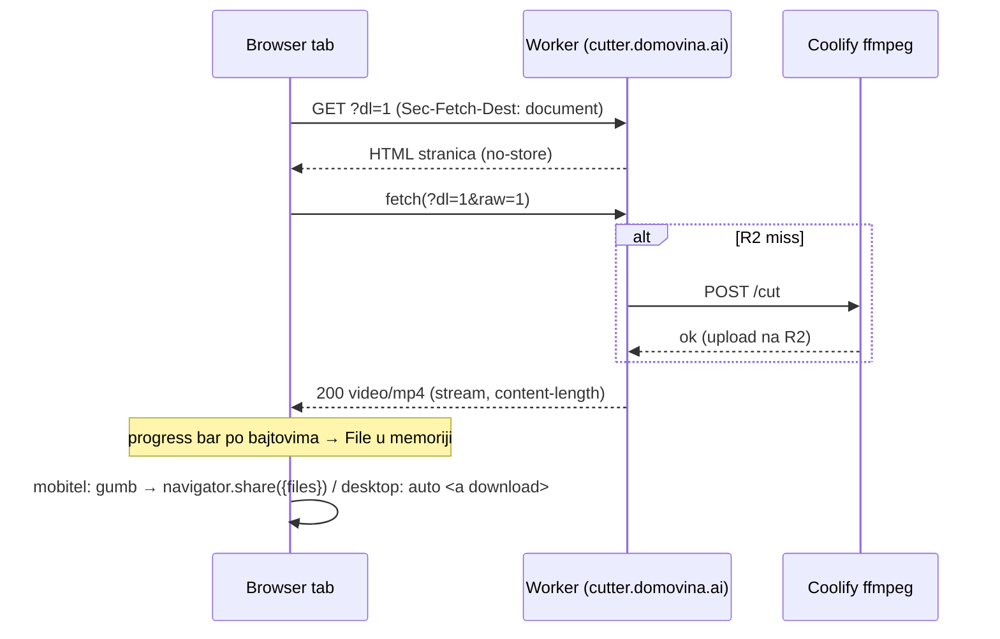

# Stranica za preuzimanje isječka + Web Share (2026-10-10)

## Problem

domovina.ai (Flutter web) otvara `…/clip/…mp4?dl=1` u novom tabu (`openUrl`
u `domovina.ai/lib/widgets/clip_share_sheet.dart`). Worker drži zahtjev otvoren
dok Coolify servis reže (hladni rez, do ~minute), pa je korisnik gledao bijeli
ekran. Na iOS-u je gotov download nudio samo Files/Drive, ne WhatsApp ni Fotografije.

## Rješenje

- Detekcija: `Sec-Fetch-Dest: document`, fallback `Accept: text/html`.
  Flutter `http`, curl i `<video>` to ne šalju → ponašanje za njih nepromijenjeno.
- Stranica se daje **samo za `?dl=1`**. Inline linkovi (bez `dl`) ostaju 302 na
  CDN — namjerno, jer ih se lijepi u poruke, a link-preview botovi i playeri ne
  smiju dobiti HTML.
- „Rezanje gotovo" = stigla su response zaglavlja (Worker odgovara tek kad je
  objekt na R2). Nakon toga je progress pravi postotak iz `content-length`.

## Zamke

- **`navigator.share` traži user gesture.** Nakon async fetcha aktivacija istekne,
  pa se share sheet ne može otvoriti automatski — zato gumb „Pošalji ili spremi video".
- Na iOS share sheetu s datotekom stoji **„Spremi video"** (u Fotografije) — to je
  bila glavna želja, uz WhatsApp.
- Ako cilj odbije datoteku, share pada natrag na dijeljenje inline linka.
- Mobitel vs desktop: `matchMedia("(pointer: coarse)")`. Desktop Chrome/Safari
  također znaju `canShare({files})`, ali tamo je auto-download očekivano ponašanje
  pa je share tek sekundarni gumb.
- Cijeli isječak drži se u memoriji (Blob) — najdulja poglavlja ~70 MB
  (27 KB/s × trajanje).
- Lokalni test: u Braveu `localhost:8787` vraća stari projekt (service worker),
  koristi `127.0.0.1:8787`. `wrangler dev` lokalno nema R2 ni `CUTTER_API_KEY`
  → hladni rez pada s 401; `wrangler dev --remote` radi protiv pravog R2.

## Otvoreno

- [ ] Test na pravom iPhoneu: pojavljuje li se WhatsApp u share sheetu i šalje li
      video (ne link); radi li „Spremi video".
- [ ] Android Chrome — isto.
- [ ] Memorija na starijem iPhoneu kod ~70 MB isječka.
